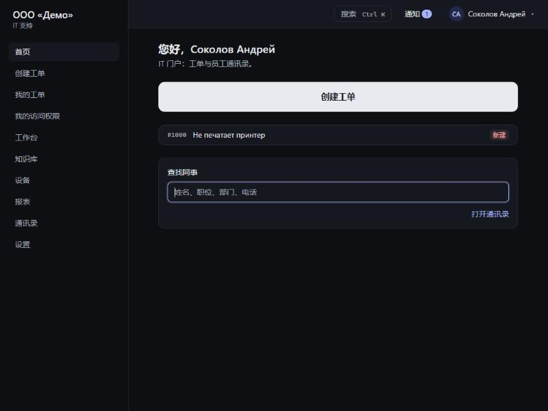

# Pult

[Русский](README.md) | **English** | [中文](README.zh-CN.md)

A self-hosted internal IT-support portal for organizations on Active Directory. Tickets, a staff directory,
access requests and AD operations, and remote support for PCs in one window. Employees sign in with their
Windows password. Open source, MIT License. Version 0.3.0.



*The interface, e-mails and error messages are in Russian, English and Chinese; the language is switched in
the profile and on the sign-in page.*

## Features

- **Tickets:** categories and templates, SLA on a working calendar, assignment by site, attachments,
  comments, recurring tickets, automation rules, knowledge base, announcements, notifications in the portal
  and by e-mail.
- **Staff directory:** synchronized from AD, phones and departments, search that corrects the keyboard
  layout, account linking, import.
- **AD directory and access:** access requests with approval; unlock, password reset and group changes from
  the ticket card, through a separate account with limited rights.
- **Remote support:** an agent on the PC reports user sessions; an engineer connects from the PC card or the
  ticket.
- **Telephony:** call log and click-to-call from the directory through the PBX.
- **Sign-in and security:** Windows password (LDAPS/StartTLS, several controllers), optional second factor
  (TOTP) for sign-in from the internet, roles and permissions, audit log with a hash chain.
- **Operations:** a single `.deb` package or Docker, a first-run wizard in the browser, updates with a
  backup and rollback, daily backups, Prometheus metrics.

## How it works

A single Rust program with a built-in web interface (React) and a PostgreSQL database on a Debian or Ubuntu
server. The portal connects to the domain controllers only over an encrypted channel and only reads the
directory; changes in AD go through a separate account and only for those who are allowed. Details:
[docs/architecture.md](docs/architecture.md) (in Russian).

## Installation

You need a Debian 13 or Ubuntu 24.04+ (x86-64) server on the domain network. Download
`pult_<version>_amd64.deb`, `install.sh` and `SHA256SUMS` from the
[Releases](https://github.com/Starevg02/pult/releases) page, then:

```bash
sha256sum -c --ignore-missing SHA256SUMS                  # verify the files
sudo sh install.sh --check --dc dc1.corp.example.test     # check the server: what to fix before installing
sudo sh install.sh ./pult_<version>_amd64.deb             # install; prints the address and the wizard code
```

Open `https://server-name/`: the wizard asks for the domain and the service account, then signs you in as
the super administrator. Step by step, with domain preparation, certificate, backups and updates:
[docs/install.en.md](docs/install.en.md).

Docker: `docker compose -f deploy/compose.yml up -d --build`
([section 11](docs/install.en.md#11-docker-instead-of-the-package)).

## Documentation

| Document | Audience and topic |
|---|---|
| [Deployment](docs/install.en.md) | Server and domain preparation, installation, certificate, backups, updates, troubleshooting |
| [Configuration and use](docs/guide.md) (Russian) | First steps, all settings sections, roles, work of employees, engineers and administrators |
| [Remote support](docs/admin-guide.md) (Russian) | PC agent, engineer helper, Windows policies |
| [Changes in AD](docs/directory.md) (Russian) | Write account, scopes, permissions, access requests |
| [Domain preparation](docs/ad-setup.md) (Russian) | Own CA, service accounts, Kerberos (groundwork for sign-in without a password), intranet zone |
| [Access from the internet](docs/go-live.md) (Russian) | Network, certificate, second factor, checks before opening |
| [How Pult works](docs/architecture.md) (Russian) | Components, code, data, decisions and the reasons for them |
| [Security](docs/security.md) (Russian) | Protection model, what the administrator should do, limitations |
| [Languages](docs/localization.md) (Russian) | How translations work |
| [Decisions (ADR)](docs/adr/) (Russian) | Why Rust, how LDAP is integrated, stack choice, job queue |
| [Changes](CHANGELOG.md) | What is new in each version |

The documentation is written in Russian; the deployment guide is also available in English
([docs/install.en.md](docs/install.en.md)).

## Security

Report vulnerabilities privately, without a public issue: [SECURITY.md](SECURITY.md).

## Contributing

Development environment, checks and building the installers: [CONTRIBUTING.md](CONTRIBUTING.md).

## License

MIT: [LICENSE](LICENSE). Emoji: the [Noto Color Emoji](https://github.com/googlefonts/noto-emoji) font (Google),
SIL Open Font License 1.1.
