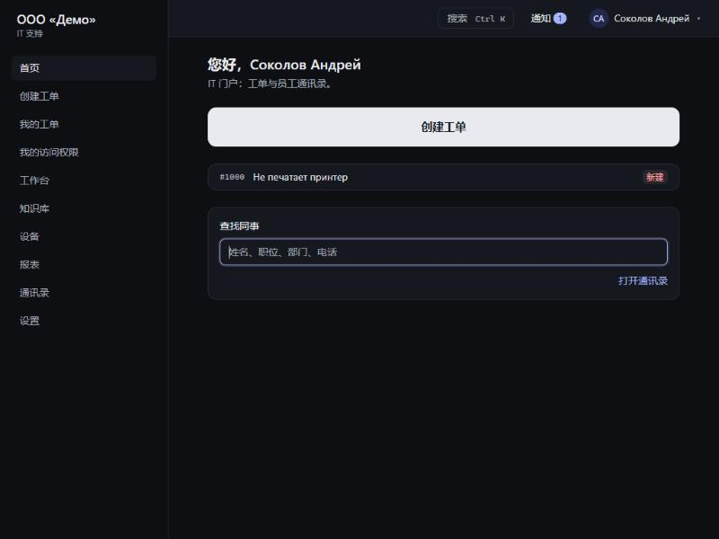

# Pult

**Русский** | [English](README.en.md) | [中文](README.zh-CN.md)

Портал внутренней IT-поддержки для организаций на Active Directory, который ставится на свой сервер.
Заявки, справочник сотрудников, доступы и операции в AD, удалённая поддержка ПК — в одном окне.
Сотрудники входят своим паролем Windows. Открытый код, лицензия MIT. Версия 0.1.0.



*Интерфейс, письма и сообщения об ошибках — на русском, английском и китайском; язык переключается в
профиле и на странице входа.*

## Что умеет

- **Заявки:** категории и шаблоны, SLA по рабочему календарю, назначение по площадкам, вложения,
  комментарии, повторяющиеся заявки, правила автоматизации, база знаний, объявления, уведомления в портале
  и по почте.
- **Справочник сотрудников:** синхронизация с AD, телефоны и подразделения, поиск с исправлением
  раскладки, связывание учёток, импорт.
- **Каталог AD и доступы:** запросы на доступ с согласованием; разблокировка, сброс пароля и группы из
  карточки заявки — через отдельную учётку с ограниченными правами.
- **Удалённая поддержка:** агент на ПК показывает сеансы пользователей, инженер подключается из карточки
  ПК или заявки.
- **Телефония:** журнал звонков и звонок из справочника через АТС.
- **Вход и безопасность:** пароль Windows (LDAPS/StartTLS, несколько контроллеров), второй фактор (TOTP)
  по желанию для входа из интернета, роли и права, журнал аудита с цепочкой хешей.
- **Эксплуатация:** один пакет `.deb` или Docker, мастер первого запуска в браузере, обновление с
  резервной копией и откатом, ежедневные копии, метрики Prometheus.

## Как устроено

Одна программа на Rust со встроенным веб-интерфейсом (React) и база PostgreSQL на сервере Debian или Ubuntu.
Портал подключается к контроллерам домена только по защищённому каналу и только читает каталог; изменения
в AD — отдельной учёткой и только тем, кому это разрешено. Подробно — [docs/architecture.md](docs/architecture.md).

## Установка

Нужен сервер Debian 13 или Ubuntu 24.04+ (x86-64) в сети домена. Скачайте со страницы
[Releases](https://github.com/Starevg02/pult/releases) файлы `pult_<версия>_amd64.deb`, `install.sh` и
`SHA256SUMS`, затем:

```bash
sha256sum -c --ignore-missing SHA256SUMS                  # проверить файлы
sudo sh install.sh --check --dc dc1.corp.example.test     # проверить сервер: что исправить до установки
sudo sh install.sh ./pult_<версия>_amd64.deb              # установить; в конце — адрес и код мастера
```

Откройте `https://имя-сервера/` — мастер спросит домен и служебную учётку, затем войдёт вами как
суперадминистратором. Пошагово, с подготовкой домена, сертификатом, копиями и обновлением —
[docs/install.md](docs/install.md).

Docker: `docker compose -f deploy/compose.yml up -d --build`
([раздел 11](docs/install.md#11-docker-вместо-пакета)).

## Документация

| Документ | Для кого и о чём |
|---|---|
| [Развёртывание](docs/install.md) | Подготовка сервера и домена, установка, сертификат, копии, обновление, неполадки |
| [Настройка и работа](docs/guide.md) | Первые шаги, все разделы настроек, роли, работа сотрудника, инженера и администратора |
| [Удалённая поддержка](docs/admin-guide.md) | Агент на ПК, helper инженера, политики Windows |
| [Изменения в AD](docs/directory.md) | Учётка записи, области, разрешения, запросы доступа |
| [Подготовка домена](docs/ad-setup.md) | Свой CA, служебные учётки, Kerberos (подготовка к входу без пароля), зона интрасети |
| [Доступ из интернета](docs/go-live.md) | Сеть, сертификат, второй фактор, проверка перед открытием |
| [Как устроен Pult](docs/architecture.md) | Компоненты, код, данные, решения и почему они такие |
| [Безопасность](docs/security.md) | Модель защиты, что сделать администратору, ограничения |
| [Языки](docs/localization.md) | Как устроены переводы |
| [Решения (ADR)](docs/adr/) | Почему Rust, как интегрирован LDAP, выбор стека, очередь задач |
| [Изменения](CHANGELOG.md) | Что нового в каждой версии |

Документация написана на русском; руководство по развёртыванию есть и на английском
([docs/install.en.md](docs/install.en.md)).

## Безопасность

Уязвимости сообщайте приватно, без публичного issue: [SECURITY.md](SECURITY.md).

## Участие в разработке

Окружение разработчика, проверки и сборка установщиков — [CONTRIBUTING.md](CONTRIBUTING.md).

## Лицензия

MIT — [LICENSE](LICENSE).
