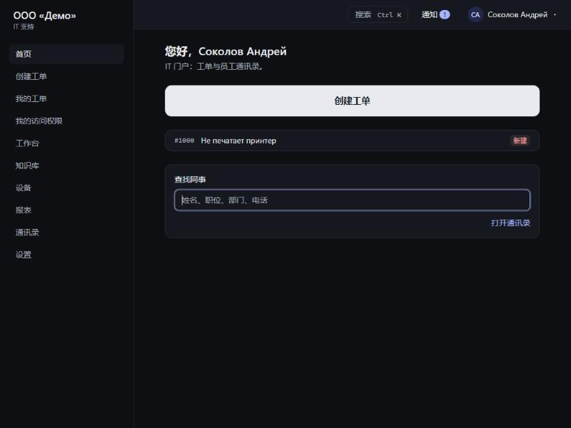

# Pult

[Русский](README.md) | [English](README.en.md) | **中文**

面向 Active Directory 组织、部署在自有服务器上的内部 IT 支持门户。工单、员工通讯录、访问权限与 AD 操作、
电脑远程支持，集中在一个界面中。员工使用自己的 Windows 密码登录。开源，MIT 许可证。版本 0.1.0。



*界面、邮件和错误信息提供俄语、英语和中文；可在个人资料和登录页面切换语言。*

## 功能

- **工单：** 类别和模板、按工作日历计算的 SLA、按站点分配、附件、评论、周期性工单、自动化规则、知识库、
  公告、门户内通知和邮件通知。
- **员工通讯录：** 与 AD 同步，电话和部门，可自动纠正键盘布局的搜索，账户关联，导入。
- **AD 目录与访问权限：** 带审批的访问申请；在工单卡片中解锁账户、重置密码、管理组——通过权限受限的
  独立账户执行。
- **远程支持：** 电脑上的代理程序报告用户会话，工程师可从电脑卡片或工单中直接连接。
- **电话系统：** 通话记录，通过电话交换机从通讯录直接拨号。
- **登录与安全：** Windows 密码（LDAPS/StartTLS，支持多个域控制器），从互联网登录时可选第二因素（TOTP），
  角色与权限，带哈希链的审计日志。
- **运维：** 一个 `.deb` 软件包或 Docker，浏览器中的首次运行向导，带备份和回滚的更新，每日备份，
  Prometheus 指标。

## 工作原理

一个内置 Web 界面（React）的 Rust 程序，加上 Debian 或 Ubuntu 服务器上的 PostgreSQL 数据库。门户只通过
加密通道连接域控制器，并且只读取目录；对 AD 的修改通过独立账户进行，且仅限获得授权的人员。详见
[docs/architecture.md](docs/architecture.md)（俄文）。

## 安装

需要一台位于域网络中的 Debian 13 或 Ubuntu 24.04+（x86-64）服务器。从
[Releases](https://github.com/Starevg02/pult/releases) 页面下载 `pult_<版本>_amd64.deb`、`install.sh` 和
`SHA256SUMS`，然后执行：

```bash
sha256sum -c --ignore-missing SHA256SUMS                  # 校验文件
sudo sh install.sh --check --dc dc1.corp.example.test     # 检查服务器：安装前需要修复的问题
sudo sh install.sh ./pult_<版本>_amd64.deb                # 安装；结束时显示访问地址和向导代码
```

打开 `https://服务器名称/`：向导会询问域和服务账户，然后以超级管理员身份为您登录。包括域准备、证书、
备份和更新在内的分步说明见 [docs/install.en.md](docs/install.en.md)（英文）。

Docker：`docker compose -f deploy/compose.yml up -d --build`
（[第 11 节](docs/install.en.md#11-docker-instead-of-the-package)）。

## 文档

| 文档 | 读者与内容 |
|---|---|
| [部署](docs/install.en.md)（英文） | 服务器和域的准备、安装、证书、备份、更新、故障排除 |
| [配置与使用](docs/guide.md)（俄文） | 入门步骤、全部设置项、角色、员工、工程师和管理员的日常工作 |
| [远程支持](docs/admin-guide.md)（俄文） | 电脑代理程序、工程师辅助程序、Windows 策略 |
| [AD 变更](docs/directory.md)（俄文） | 写入账户、范围、权限、访问申请 |
| [域准备](docs/ad-setup.md)（俄文） | 自有 CA、服务账户、Kerberos（为免密码登录做准备）、本地 Intranet 区域 |
| [互联网访问](docs/go-live.md)（俄文） | 网络、证书、第二因素、开放前检查 |
| [Pult 架构](docs/architecture.md)（俄文） | 组件、代码、数据、设计决策及其原因 |
| [安全](docs/security.md)（俄文） | 防护模型、管理员需要做的事、已知限制 |
| [语言](docs/localization.md)（俄文） | 翻译的组织方式 |
| [架构决策（ADR）](docs/adr/)（俄文） | 为什么选择 Rust、LDAP 如何集成、技术栈选择、任务队列 |
| [变更记录](CHANGELOG.md) | 每个版本的新内容 |

文档以俄文编写；部署指南另有英文版（[docs/install.en.md](docs/install.en.md)）。

## 安全

请私下报告漏洞，不要创建公开 issue：[SECURITY.md](SECURITY.md)。

## 参与开发

开发环境、检查和安装包构建：[CONTRIBUTING.md](CONTRIBUTING.md)。

## 许可证

MIT：[LICENSE](LICENSE)。
